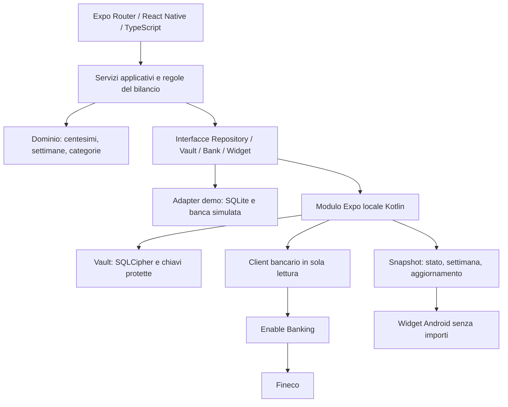

> **Architettura attuale verificata il 19 ottobre 2026:** [mappa completa di componenti, file e funzioni](ARCHITETTURA_COMPLETA.md). Il documento sotto rimane storico.

> Documento storico, precedente alla rimozione della demo del 17 ottobre 2026. Per il funzionamento attuale leggi README.md e STATO_IMPLEMENTAZIONE.md. Non è presente un collegamento bancario.

# Architettura SpeseProfit

Stato al 15 ottobre 2026: il vault SQLCipher e il modulo widget sono implementati. Il vault ha superato otto test strumentali su Android 16; il collegamento bancario descritto sotto resta un progetto, attualmente sostituito soltanto dal simulatore. La build protetta mantiene l'etichetta dati fittizi fino alle prove complete. Vedi [implementazione del vault](ARCHIVIO_PROTETTO.md).

## 1. Obiettivo e vincoli

App Android personale: registra l'incasso totale della settimana, importa le spese Fineco e mostra entrate meno uscite. Il risultato è un bilancio personale, non una misura del profitto fiscale dell'attività.

I dati restano sul telefono dopo l'importazione. Il collegamento bancario passa comunque attraverso Enable Banking e Fineco. Nessun backend gestito da SpeseProfit, nessun abbonamento, analytics o pubblicità. L'accesso gratuito al fornitore deve rimanere entro le condizioni di uso personale.

### Expo Go e versione reale

| Capacità | Prototipo Expo Go | Development build / APK Android |
|---|---|---|
| Schermate, incasso manuale, categorie, calcoli | Sì, dati fittizi | Sì |
| Persistenza | SQLite separato con dati fittizi | SQLCipher locale cifrato |
| Password | Dimostrazione del flusso, senza promessa di sicurezza | Password che apre il vault cifrato |
| Collegamento bancario | Simulatore, nessuna credenziale | Integrazione nativa dopo verifica di fattibilità |
| Widget sulla home Android | Anteprima dentro l'app | AppWidgetProvider Kotlin |
| Esclusione backup e trasferimento dispositivo | Non verificabile come app autonoma | Configurazione Android e prove su dispositivo |

Expo Go non permette moduli nativi aggiuntivi. La documentazione Expo indica inoltre che SQLCipher non è disponibile in Expo Go. `expo-widgets`, alla data della verifica, riguarda iOS: non è la soluzione per il widget Android.

Fonti: [Expo Go e development builds](https://docs.expo.dev/develop/development-builds/faq/), [SQLite/SQLCipher](https://docs.expo.dev/versions/latest/sdk/sqlite/), [Expo Widgets](https://docs.expo.dev/versions/latest/sdk/widgets/).

## 2. Componenti



- **UI:** Expo Router, React Native, TypeScript; nessuna logica di calcolo negli elementi visuali.
- **Dominio:** funzioni pure per settimane, totali e regole di categorizzazione. Importi in centesimi interi, mai float monetari.
- **Servizi applicativi:** inserimento incasso, spesa manuale, aggiornamento bancario, correzione categoria, cambio password e disconnessione.
- **Adapter demo:** SQLite in Expo Go per soli dati fittizi, banca simulata e anteprima widget. Etichetta permanente “Demo — dati fittizi”.
- **Adapter reale:** modulo Kotlin locale tramite Expo Modules API. Operazioni sul vault, crittografia, firma delle richieste bancarie e aggiornamento widget rimangono native; nessuna chiave privata o token esposti al bridge JS.
- **Widget:** implementazione Android nativa con RemoteViews/AppWidgetProvider. Riceve solo uno snapshot privo di importi e descrizioni.
- **Configurazione build:** config plugin per manifest, backup rules, widget, deep link e dipendenze native. Le modifiche devono sopravvivere a `expo prebuild --clean`.

Struttura prevista:

```text
app/                         # route e schermate Expo Router
src/domain/                  # tipi e funzioni pure
src/application/             # casi d'uso
src/ports/                   # contratti degli adapter
src/adapters/demo/           # implementazioni Expo Go
src/adapters/native/         # wrapper tipizzati del modulo Kotlin
src/ui/                      # componenti condivisi
modules/speseprofit-native/  # vault, banca e widget Android
plugins/                     # configurazione Android riproducibile
tests/                       # dominio e contratti degli adapter
docs/                        # questi documenti
```

Scegliere la versione stabile Expo compatibile con Expo Go installato al momento del bootstrap; fissare SDK, dipendenze e lockfile. Niente dipendenze `latest` nella configurazione finale. Versione minima Android: quella supportata dall'SDK scelto, da registrare nel README prima della prima build.

## 3. Dati e interfacce

Nel vault cifrato:

| Entità | Contenuto minimo |
|---|---|
| Account | ID locale, tipo Fineco/contanti, riferimento del fornitore |
| Transaction | ID, origine, riferimento banca, data contabile, importo con segno in centesimi, descrizione, categoria, esclusione/trasferimento |
| WeeklyCashIncome | Lunedì della settimana, totale incasso in centesimi, ultima modifica; un record per settimana |
| Category | ID, nome, tipo entrata/spesa, archivio delle categorie personalizzate |
| CategoryRule | Testo normalizzato da riconoscere, categoria, priorità; le correzioni manuali prevalgono |
| BankConnection | Identificatori di sessione/account e stato della connessione |
| SyncState | Ultimo completamento, cursore e stato di errore senza dati sensibili |

L'incasso settimanale è separato dalle transazioni di conto: aggiornarlo sostituisce il valore esistente, non aggiunge una seconda entrata. Una settimana senza incasso registrato è incompleta; inserire esplicitamente zero la completa.

Contratti TypeScript esposti all'applicazione:

```ts
type WeekKey = string; // YYYY-MM-DD del lunedì, Europe/Rome
type BalanceState = 'positive' | 'negative' | 'even' | 'incomplete';

interface LedgerRepository {
  setWeeklyCashIncome(week: WeekKey, cents: number): Promise<void>;
  addCashExpense(input: CashExpenseInput): Promise<string>;
  getWeeklySummary(week: WeekKey): Promise<WeeklySummary>;
  listTransactions(query: TransactionQuery): Promise<TransactionPage>;
  updateClassification(id: string, input: ClassificationInput): Promise<void>;
}
interface VaultPort {
  setup(password: string): Promise<void>;
  unlock(password: string): Promise<void>;
  lock(): Promise<void>;
  changePassword(current: string, next: string): Promise<void>;
}
interface BankPort {
  beginConnection(): Promise<{ authorizationUrl: string }>;
  completeConnection(callbackUrl: string): Promise<void>;
  sync(): Promise<SyncResult>;
  disconnect(): Promise<DisconnectResult>;
}
interface WidgetPort {
  publish(snapshot: WidgetSnapshot): Promise<void>;
}
```

I tipi di input/dettaglio verranno definiti con le entità sopra nella prima fase. Tutti i metodi finanziari falliscono con `VAULT_LOCKED` se manca una sessione locale aperta. Nessuna interfaccia per backup, export, restore o pagamenti.

## 4. Calcoli e importazione

- Settimana calendario lunedì–domenica in Europe/Rome; banca per data contabile, contanti per data scelta e incasso per settimana selezionata.
- Saldo = incasso contanti + accrediti bancari inclusi − addebiti bancari inclusi − spese contanti.
- Saldi iniziali dei conti non sono entrate; trasferimenti, versamenti di contanti già registrati e prelievi non sono spese o entrate.
- Non indovinare silenziosamente un versamento: consentire la marcatura come trasferimento, con suggerimenti basati sulla descrizione. La classificazione manuale è preservata alle sincronizzazioni successive.
- Considerare i soli movimenti contabilizzati. I rimborsi bancari contabilizzati aumentano il saldo della loro settimana; non riscrivere automaticamente le settimane precedenti.
- Importare il conto corrente EUR Fineco della carta di debito; non importare in parallelo gli stessi acquisti da un conto carta separato.
- Usare identificatori stabili del fornitore per deduplicare. Se mancano, implementare un controllo delle collisioni che preservi acquisti identici legittimi: data/importo/descrizione non sono da soli una chiave unica affidabile.
- Importazione iniziale: ultimi 90 giorni, se disponibili. Aggiornamenti: finestra sovrapposta di 30 giorni e refresh esplicito di settimane precedenti, per recepire registrazioni tardive senza promettere uno storico completo.
- Scrittura importata e aggiornamento dei totali in una transazione; errori di rete non cancellano lo storico.
- Categorie iniziali: alimentari, ristorazione, trasporti, casa/utenze, salute, acquisti, svago, altre spese; entrate distinte. Sconosciuti in “Da categorizzare”. Nessun invio dei movimenti a servizi AI.

## 5. Password, vault e blocco

Password locale come modalità iniziale della versione reale; passkey e biometria non fanno parte della prima implementazione.

- Minimo 16 caratteri, massimo 128, spazi ammessi, lista locale di password comuni vietate. Nessuna composizione artificiale o scadenza periodica. Gestire la normalizzazione Unicode in modo identico in creazione e sblocco; non tagliare o cambiare maiuscole/spazi silenziosamente.
- Generare una chiave casuale per il database. Argon2id con salt casuale deriva dalla password una chiave che protegge la chiave del vault con cifratura autenticata. Proteggere ulteriormente il materiale persistito con una chiave Android Keystore associata all'installazione.
- Usare librerie native mantenute, non implementazioni crittografiche scritte da zero. Minimi Argon2id OWASP: 19 MiB, 2 iterazioni, parallelismo 1; calibrare verso circa 500 ms sul telefono senza scendere sotto i minimi. Parametri memorizzati con versione e salt, senza password.
- Chiave database utilizzata solo nel codice nativo; per questa separazione preferire accesso SQLCipher dal modulo Kotlin, anziché passare la chiave a JavaScript tramite `expo-sqlite`.
- Dopo cinque errori: attesa di 30 secondi, poi raddoppio fino a 15 minuti; stato dei tentativi persistente. Nessuna cancellazione automatica. Il limite dell'interfaccia non impedisce attacchi offline su dati estratti.
- Bloccare su background, schermo spento o inattività di due minuti; chiudere database, interrompere importazione e cancellare stato sensibile in UI. Rilascio/azzeramento dei buffer nativi per quanto possibile; nessuna promessa di cancellazione perfetta di stringhe nel runtime JS.
- Il browser bancario porta l'app in background: il vault si blocca. Al ritorno conservare solo in memoria la risposta temporanea e richiedere nuovamente la password prima di completare la connessione; se il processo termina, riavviare l'autorizzazione.
- Nessun recupero password: dimenticarla rende inaccessibili i dati locali. Azzerare e ricollegare la banca non recupera gli incassi manuali.

Fonti: [NIST](https://pages.nist.gov/800-63-4/sp800-63b.html), [OWASP Argon2id](https://cheatsheetseries.owasp.org/cheatsheets/Password_Storage_Cheat_Sheet.html), [Android Keystore](https://developer.android.com/privacy-and-security/keystore).

## 6. Collegamento bancario

Enable Banking, production restricted mode per i propri conti personali. La documentazione conferma uso personale gratuito e copertura Fineco; l'accesso sul conto specifico deve essere provato.

- L'utente registra la propria applicazione e collega il proprio conto presso il fornitore; nessuna credenziale condivisa tra installazioni.
- Chiave privata generata nel Keystore sul dispositivo e registrazione della sola chiave pubblica/certificato, se il flusso del fornitore lo permette: verificare questo percorso nel primo spike. Mai `EXPO_PUBLIC_*` per segreti, `.env` incorporati o chiavi nel repository.
- Client HTTP e firma JWT nel modulo nativo; token e identificatori sensibili nel vault. Implementare soltanto autenticazione, conti, transazioni e chiusura sessione; nessuna chiamata per disporre pagamenti.
- Browser esterno, callback registrata, `state` casuale monouso con scadenza, confronto esatto prima dello scambio; rifiutare callback inattese. Il ritorno all'app va provato in una development build. Confermare con il fornitore il redirect ammesso senza server: un requisito di hosting a pagamento bloccherebbe il vincolo costo zero.
- Sincronizzazione solo dopo sblocco con rete disponibile; niente background worker finanziario. Rispettare rate limit e richieste di rinnovo consenso; nessun ciclo aggressivo di tentativi.
- “Disconnetti” chiude la sessione remota e rimuove le credenziali locali. Se la rete fallisce, chiarire che la revoca remota non è completata e indicare il percorso di revoca in banca/fornitore.

Fonti: [Termini personali](https://enablebanking.com/terms/), [API](https://enablebanking.com/docs/api/reference/), [Fineco](https://enablebanking.com/blog/2026/04/08/enable-banking-changelogmarch-2026).

## 7. Widget e stato esposto

Snapshot separato: `{ weekStart, balanceState, lastSuccessfulSyncAt, calculatedAt }`. Nessun importo, descrizione, categoria, numero di conto o credenziale.

- Positivo / Negativo / In pareggio: ultimo risultato calcolato con incasso presente.
- Da completare: manca l'incasso della settimana, anche se ci sono già spese.
- Da aggiornare: nuova settimana senza snapshot, oppure ultimo aggiornamento bancario più vecchio di 24 ore. Non mostrare il segno vecchio come se fosse attuale.
- Testo e icona, non solo colore. Mostrare la data di aggiornamento per evitare impressioni di tempo reale.
- Tocco sul widget apre lo sblocco. Il widget non legge il vault e non effettua richieste alla banca.
- Su reset/disconnessione rendere lo snapshot non aggiornato; su cancellazione completa eliminarlo. Calcolare autonomamente il cambio settimana con date non sensibili quando il sistema ridisegna il widget, oltre all'aggiornamento alla mezzanotte di lunedì.

## 8. Distribuzione e superfici escluse

- APK release firmato per uso personale; chiave di firma custodita fuori repository. Aggiornamenti con stessa firma.
- Nessun aggiornamento OTA remoto nella prima versione; bundle JS incluso nell'APK release. Development build e Expo Go solo per sviluppo, senza dati reali persistenti di produzione.
- `android:allowBackup=false` e regole esplicite per cloud backup e device transfer. Provare anche sul telefono reale: alcuni trasferimenti OEM possono avere comportamenti differenti e non si promette esclusione universale senza verifica.
- Nessuna funzione backup, export, restore o “password dimenticata”. Nessun permesso contatti, posizione, SMS o notifiche altrui.
- Proteggere screenshot/anteprima delle schermate sensibili, ridurre overlay pericolosi e non esportare componenti Android salvo callback/widget strettamente necessari.
- Limitare log a codici di errore; mai password, JWT, callback completi, importi o descrizioni. Release senza strumenti di debug.
- Telefono compromesso e accesso ai dati durante una sessione aperta restano rischi; password e cifratura non garantiscono sicurezza assoluta.
