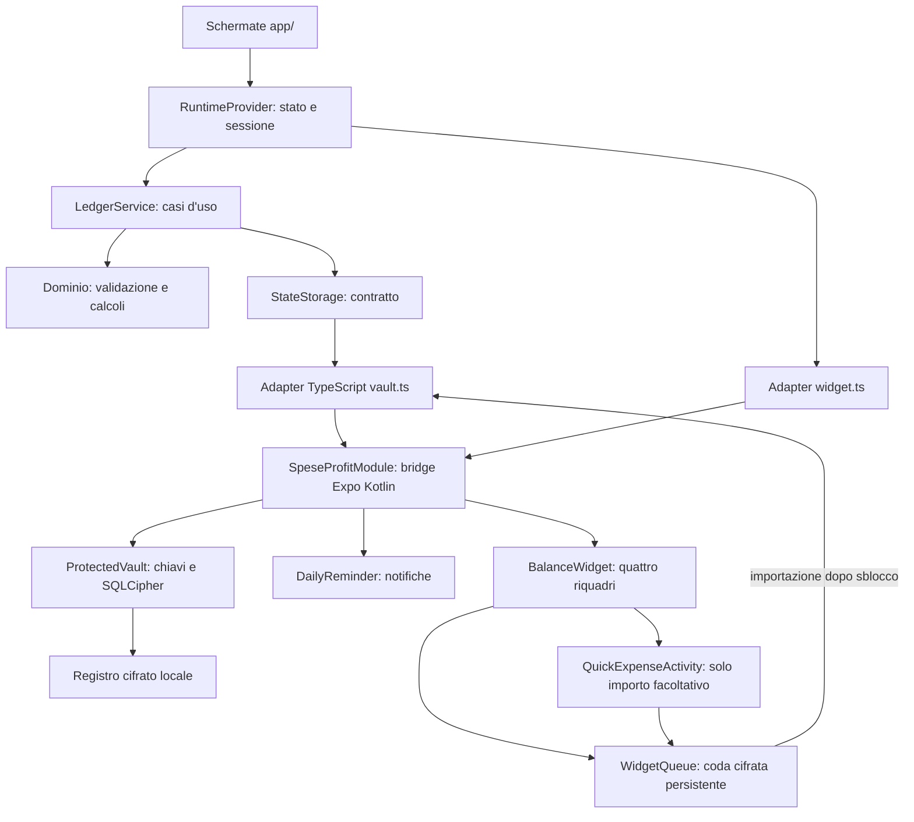

# SpeseProfit — architettura completa e mappa dei file

> Aggiornamento SP-DS-001: [mappa delle modifiche e delle nuove funzioni](IMPLEMENTAZIONE_DESIGN.md). Analisi Giorno/Settimana, dettaglio/modifica dedicati, tema scuro e nuova configurazione widget sostituiscono i precedenti flussi UI.

Verifica dei sorgenti: **21 ottobre 2026**. Questo documento descrive l'applicazione presente nel progetto, non una proposta futura.

## 1. Posizione del progetto e piattaforma

**Radice:** cartella del repository.

Tutti i percorsi relativi riportati sotto partono dalla radice del repository.

| Voce | Implementazione attuale |
|---|---|
| Piattaforma | Android; APK dedicato utilizzabile offline |
| Versione | Nome `0.1.0`; Android `versionCode 4` |
| Package release | `it.speseprofit.personal` |
| Package debug | `it.speseprofit.personal.dev` |
| Interfaccia | React Native 0.86.3, React 19.2.3, Expo 57.0.27 |
| Navigazione | Expo Router 57.0.25, stack e tab JavaScript, header React condivisi e GestureHandlerRootView |
| Linguaggi | TypeScript 6.0.3 e Kotlin; Gradle/CMake per la compilazione |
| Archivio | SQLCipher nel modulo Android personalizzato |
| Autenticazione | Password locale; passkey e biometria non implementate |
| Acquisizione dati | Inserimento manuale, modelli rapidi, richieste dal widget |
| Collegamenti esterni | Nessuna integrazione Fineco/Enable Banking o backend applicativo |
| Backup e recupero | Nessuna funzione di backup, esportazione, sincronizzazione o recupero password |

Expo Go e browser non permettono l'utilizzo dell'archivio protetto e del widget reali. Non è più presente una modalità demo operativa. Il saldo dell'app è la differenza fra i dati registrati, non il saldo bancario né la totalità dei risparmi posseduti.

## 2. Architettura generale



Le schermate raccolgono input e mostrano risultati. Il dominio contiene le regole di calcolo. Il servizio applicativo serializza le modifiche e pubblica il nuovo stato solo dopo il salvataggio riuscito. L'adapter collega TypeScript al modulo Android, che custodisce le chiavi e verifica autonomamente la sessione. Widget e promemoria operano anche con archivio bloccato usando soltanto i dati limitati predisposti per loro.

## 3. Cartelle e responsabilità

```text
SpeseProfit-App/
  app/                         schermate e navigazione Expo Router
  src/
    ui/                        sessione UI, blocco, calendario, componenti
    domain/                    tipi, validazione e calcoli
    application/               casi d'uso: LedgerService
    ports/                     contratto StateStorage
    adapters/native/           collegamenti TypeScript al modulo Android
  modules/speseprofit-native/
    android/src/main/          implementazione Kotlin e risorse widget
    android/src/androidTest/   test nativi
  android/                     progetto host da aprire in Android Studio
  plugins/                     configurazione Android applicata da Expo
  scripts/                     build, firma, installazione e strumenti
  assets/branding/             icone e sorgenti del marchio
  tests/                       test TypeScript
  docs/                        documentazione e verifiche
  work/                        APK, log, cache e strumenti di sviluppo
  node_modules/                dipendenze installate
```

I sorgenti da conservare sono `app`, `src`, `modules`, `plugins`, `scripts`, asset e configurazioni. `android` è l'host nativo, in parte generato e configurato dai plugin. `node_modules`, build e cache non contengono il registro finanziario del telefono. **`work/signing` contiene però materiale privato di firma necessario agli aggiornamenti compatibili: non è una normale cache da cancellare o condividere.**

## Rimborsi e prestiti — aggiornamento 21 ottobre 2026

[Mappa completa delle nuove funzioni e dei relativi file](RIMBORSI_PRESTITI.md). Le route `rimborso.tsx`, `prestito.tsx`, `restituzione.tsx` usano `CreditForms.tsx`; `rimborsi-prestiti.tsx` contiene ricerca, totali e storico. I dati restano nell’archivio protetto.

## 4. Schermate e funzioni associate

| File dalla radice | Componente | Funzione e collegamenti |
|---|---|---|
| `app/_layout.tsx` | `RootLayout`, `Content` | Avvio, protezione schermate, provider runtime; schermata password finché bloccato, navigazione dopo sblocco. |
| `app/(tabs)/_layout.tsx` | `TabLayout` | Barra a cinque colonne: Home, Movimenti, +, Analisi, Impostazioni. |
| `app/(tabs)/index.tsx` | `Home` | Solo settimana corrente, entrate, spese, bilancio e cinque barre; controllo della giornata. Storico in Analisi. |
| `app/incasso.tsx` | `CashIncome` | Totale della settimana corrente dal + o storica tramite parametro contestuale, sostituzione e zero esplicito. Usa `setWeeklyCashIncome`. |
| `app/spesa.tsx` | `ExpenseRoute`, `ExpenseEditor` | Nuova spesa tramite `ExpenseEditor`, categoria richiesta, descrizione facoltativa, data iniziale oggi; `addExpense`, `templateDraft`. |
| `app/(tabs)/movimenti.tsx` | `Transactions` | Ricerca, filtri ed elenco compatto; apertura dettaglio dedicato tramite `TransactionRow` e `searchMovements`. |
| `app/(tabs)/analisi.tsx` | `AnalysisRoute`, `Analysis` | Vista Giorno/Settimana con calendario, top tre spese, grafico e accesso allo storico. |
| `app/movimento.tsx` | `MovementDetail` | Dettaglio spesa, accesso alla modifica ed eliminazione confermata. |
| `app/modifica-spesa.tsx` | `EditExpense` | Carica la spesa identificata e usa `ExpenseEditor` per modificarla. |
| `app/categorie.tsx` | `Categories` | Aggiunta categorie e visualizzazione regole; `addCategory`. Le regole si possono creare modificando un movimento. |
| `app/rapido.tsx` | `QuickEntry`, `TemplateEditor` | Crea/modifica/elimina modelli; apre una spesa precompilata. Usa `saveExpenseTemplate`, `deleteExpenseTemplate`. |
| `app/mese.tsx` | `MonthlyRoute`, `MonthlyBalance` | Calendario, esiti settimanali, totali del mese e classifica categorie con importi e percentuali. Usa `monthlyCalendar`, `monthlySummary`. |
| `app/anno.tsx` | `AnnualRoute`, `AnnualBalance` | Dodici mesi, grafico, totali annuali, accesso al calendario di un mese. Usa `annualSummary`. |
| `app/confronto.tsx` | `ComparisonRoute`, `MonthComparison`, `MonthPicker` | Due mesi a confronto, periodo equivalente/intero e variazioni per categoria. Usa `compareMonths`. |
| `app/accumulato.tsx` | `Accumulated` | Differenza accumulata, settimana iniziale e dati mancanti. Usa `accumulatedReport`, `setAccumulationStart`. |
| `app/giornata.tsx` | `Day` | Controllo movimenti di oggi e conferma/annullamento giornata completata. Usa `completeToday`. |
| `app/promemoria.tsx` | `Reminder` | Orario, attivazione, permesso notifiche e stato pianificazione. Usa `setDailyReminder` e adapter `reminder.ts`. |
| `app/sicurezza.tsx` | `Security` | Cambio password locale con conferma. Usa `changePassword`. |
| `app/sessione.tsx` | `SessionSettings` | Durata sessione: 0/1/5/15/30 minuti, configurazione nativa con `configureSessionTimeout`. |
| `app/widget.tsx` | `WidgetSettings` | Tre scorciatoie Categoria/Spesa frequente, anteprima, contatori e scarto con conferma. Usa `configureWidgetShortcuts`, `widgetQueueStatus`, `discardPendingWidget`. |
| `app/(tabs)/impostazioni.tsx` | `Settings` | Accesso configurazioni, blocco e azzeramento registro con conferma; `lock`, `reset`. |

**Differenza tra i due inserimenti rapidi:** nell'app il modello apre una spesa modificabile e serve premere Salva. Nel widget il tocco salva subito una richiesta cifrata se è presente un importo preimpostato; altrimenti chiede l’importo nella schermata Android minima. Il registro viene aggiornato al successivo sblocco.

La navigazione usa `expo-router/js-stack` e `expo-router/js-tabs`, dentro `GestureHandlerRootView`. Gli header secondari sono disegnati da `Page`; questo evita il conflitto fra header e container nativi rilevato nel collaudo Android.

## 5. Runtime, sessione e componenti comuni

| File | Simboli / responsabilità |
|---|---|
| `src/ui/context.tsx` | `RuntimeProvider`, `useRuntime`: registro aperto, settimana, errori, caricamento, servizio e ticket. `openVault` crea/apre; `run` applica un caso d'uso; `lock`, `suspend`, `resume`, `release` gestiscono il ciclo di vita; `touchActivity` rinnova l'attività. Espone `configureSessionTimeout`, `changePassword`, `discardPendingWidget`. Dopo variazione del registro pubblica lo snapshot widget. Generazioni e riferimenti impediscono a risultati asincroni precedenti di riaprire la UI dopo blocco. |
| `src/ui/LockScreen.tsx` | `LockScreen`: creazione/sblocco password, conferme iniziali e stati archivio assente/pronto/danneggiato/non disponibile. |
| `src/ui/ScreenPrivacy.tsx` | `ScreenPrivacy`, `AndroidPrivacy`: attivazione `expo-screen-capture` prima di mostrare la UI; errore e Riprova se la protezione fallisce. |
| `src/ui/DateField.tsx` | Campo data con calendario condiviso e navigazione dei mesi. |
| `src/ui/components.tsx` | `Page`, `Card`, `Button`, `Field`, `Choice`, `Choices`: impaginazione e input riutilizzabili. |
| `src/ui/theme.ts` | Palette e stili. UI, icona e widget usano blu notte/champagne. |
| `src/domain/session.ts` | `SESSION_OPTIONS`, `assertSessionTimeout`, `SessionWindow`: durata, attività, scadenza e possibilità di ripresa; non custodisce password o chiavi. |

Durate: Subito, 1, 5, 15 o 30 minuti di inattività. Con Subito, il background richiede nuovo sblocco e l'inattività in primo piano scade dopo due minuti. Con durata selezionata il nativo può conservare temporaneamente la chiave in RAM; il background invalida comunque il vecchio ticket. Una ripresa valida ne ottiene uno nuovo. Arresto del processo e riavvio richiedono la password.

## 6. Dominio e regole di calcolo

| File | Funzioni / tipi principali | Responsabilità |
|---|---|---|
| `src/domain/model.ts` | `LedgerState`, `Transaction`, `ExpenseTemplate`, `Category`, `CategoryRule`, `WeeklySummary`, `WidgetSnapshot`, `WidgetView`, `emptyLedger`, `cloneLedger`, `initialCategories` | Contratti dati, categorie iniziali, creazione/copia del registro. |
| `src/domain/ledger.ts` | `validateDate`, `romeDate`, `shiftDate`, `weekOf`, `assertCents`, `parseMoney`, `money` | Date, settimane Europe/Rome, centesimi interi e formattazione. |
| `src/domain/ledger.ts` | `normalize`, `categoryFor`, `summary`, `widgetSnapshot`, `widgetView`, `passwordProblem` | Classificazione locale, riepilogo settimanale, stato widget e controllo preliminare password. |
| `src/domain/calendar.ts` | `calendarDays`, `calendarMonth`, `displayDate`, `displayMonth` | Celle del calendario e testi delle date. |
| `src/domain/monthly.ts` | `monthStart`, `monthEnd`, `shiftMonth`, `monthlySummary`, `monthlyCalendar`, `WeeklyClosure` | Totali mensili, classifica categorie, esiti delle settimane. |
| `src/domain/reports.ts` | `annualSummary`, `change`, `compareMonths`, `ComparisonMode` | Vista annuale e confronto mesi. |
| `src/domain/progress.ts` | `validateReminder`, `validateMonday`, `validateCompletedDays`, `weeklyReport`, `accumulatedReport` | Promemoria/giornate, confronto settimanale e accumulo. |
| `src/domain/search.ts` | `MovementFilters`, `searchMovements` | Ricerca locale su descrizione/categoria, senza distinzione di accenti/maiuscole, e filtri. |
| `src/domain/templates.ts` | `TemplateInput`, `validateTemplate`, `validateTemplates`, `templateDraft` | Modelli validi e spesa precompilata con data di oggi. |
| `src/domain/widgetQueue.ts` | `WidgetExpense`, `validateWidgetSlots`, `validateImportedIds`, `validateWidgetExpense` | Tre posizioni, identificativi importati e coerenza richiesta/data/modello. |
| `src/domain/migration.ts` | `loadLedger` | Caricamento validato, formati supportati e migrazione al formato 2. Vecchie simulazioni rese inerti. |

### Regole che incidono sul risultato

1. Spese negative nel registro, importi di input positivi; conversione centralizzata nel servizio. Calcoli in centesimi interi.
2. `cashIncome` contiene un totale manuale per lunedì: modificarlo sostituisce il precedente. Il nome tecnico è storico e non implica un collegamento bancario.
3. Incasso assente = dato mancante; zero salvato = nessun incasso confermato. Il primo rende il bilancio incompleto/provvisorio.
4. Solo `classification: included` contribuisce ai totali. `transfer` ed `excluded` restano nello storico.
5. Incasso settimanale assegnato una volta al mese del lunedì; spese assegnate al mese della propria data. I segni del calendario descrivono settimane intere, anche a cavallo del mese: non si sommano per ricavare il mensile.
6. Percentuali categorie: quota sulle **uscite del mese**, non sulle entrate.
7. `weeklyReport` limita la settimana in corso a oggi e confronta lo stesso tratto della precedente; `accumulatedReport` esclude date future. `summary` calcola invece tutta la settimana ed è usato anche per lo snapshot widget. Eventuali spese con data futura possono quindi produrre ambiti temporali diversi tra viste.
8. L'annuale esclude mesi futuri. Il confronto equivalente usa lo stesso numero di giorni se è coinvolto il mese corrente. Una variazione percentuale con base zero non viene inventata.
9. Categorie automatiche: ultima regola personalizzata compatibile, poi regole predefinite, altrimenti Da categorizzare. Nessun servizio AI remoto.

## 7. Servizio applicativo e contratto storage

**File:** `src/application/ledgerService.ts`.

`LedgerService` possiede una copia del registro e una coda Promise che serializza le scritture. `mutate` clona, modifica, salva e solo dopo pubblica il nuovo stato; una scrittura fallita non è presentata come riuscita.

| Metodo | Operazione |
|---|---|
| `init`, `read`, `dispose` | Caricamento/migrazione prima della visualizzazione, lettura per copia e invalidazione. |
| `setWeeklyCashIncome` | Inserisce/sostituisce il totale settimanale, zero compreso. |
| `addExpense` | Valida campi, assegna identificativo/categoria e registra spesa. |
| `updateExpense` | Modifica tutti i campi e inclusione; può salvare una regola nella stessa modifica. |
| `deleteExpense` | Elimina una spesa esistente. |
| `updateClassification` | Categoria/inclusione di un movimento ed eventuale regola. |
| `addCategory` | Categoria personalizzata, controlli lunghezza e duplicati. |
| `saveExpenseTemplate`, `deleteExpenseTemplate` | Crea/modifica/elimina modello; eliminazione svuota le posizioni widget associate. |
| `configureWidgetSlots` | Esattamente tre riferimenti validi, senza duplicati non vuoti. |
| `importWidgetExpenses` | Importa il lotto validato e conserva gli ID per impedire doppioni anche dopo eliminazione manuale della spesa. |
| `setAccumulationStart` | Sceglie/rimuove settimana iniziale dell'accumulo. |
| `setDailyReminder`, `completeToday` | Preferenze avviso e conferma della giornata. |
| `reset` | Ripristina `emptyLedger`, rimuovendo dati/preferenze del registro; non cambia la password e non equivale a distruggere tutte le chiavi native. |

Helper: `validateExpense`, `expenseFields`, `applyRule`, `assertOpen`, `mutate`. Centralizzano validazione, segno degli importi, regole e validità del servizio.

**Contratto:** `src/ports/index.ts` contiene `StateStorage.load(): Promise<unknown>` e `save(state): Promise<void>`. Il servizio non conosce SQLCipher: l'adapter implementa queste due operazioni.

## 8. Adapter TypeScript e API del bridge

| File | Funzioni / ruolo |
|---|---|
| `src/adapters/native/vault.ts` | `vaultStatus`, `openProtectedVault`, `resumeProtectedVault`, `getProtectedSessionTimeout`, `setProtectedSessionTimeout`, `lockProtectedVault`, `touchProtectedVault`, `changeProtectedPassword`, `discardProtectedWidgetPending`; controlli disponibilità. `serviceForTicket` costruisce lo storage; `importPending` importa la coda e conferma rimozione solo dopo salvataggio. |
| `src/adapters/native/widget.ts` | `publishNativeWidget`, `clearNativeWidget`, `widgetQueueStatus`; `nativeWidgetAvailable`, `widgetQuickAvailable`. Stato senza importi e metadati numero/errori coda. |
| `src/adapters/native/reminder.ts` | `reminderAvailable`, `reminderStatus`, `requestReminderPermission`: permesso e pianificazione effettiva. |

**Radice Kotlin:** `modules/speseprofit-native/android/src/main/java/it/speseprofit/nativebridge/`.

| File | Funzioni / responsabilità |
|---|---|
| `SpeseProfitModule.kt` | Registra `SpeseProfitNative` in Expo Modules API; gestisce lifecycle e sincronizzazione `lifecycleGuard`; espone API sotto elencate. |
| `ProtectedVault.kt` | `status`, `create`, `unlock`, `read`, `write`, `changePassword`, `lock`, `dispose`, `foreground`, `background`, `touch`, `sessionTimeout`, `configureSessionTimeout`, `resume`, `widgetQueueKeys`. SQLCipher, chiavi, password, tentativi e scadenza nativa. |
| `WidgetQueue.kt` | `seal`, `unseal`, `status`, `publish`, `enqueue`, `pending`, `acknowledge`, `discard`, `reset`, `resetAfterLedgerSave`, `markError`. File atomico, crittografia, configurazione pulsanti e coda. |
| `BalanceWidget.kt` | `onReceive`, `onUpdate`, `refresh`, `createViews`: quattro riquadri, ricezione tocchi, controllo widget/token e messaggi di conferma/errore. |
| `DailyReminder.kt` | Oggetto `DailyReminder`, classe `DailyReminderReceiver`; `day`, `nextTime`, `channel`, `allowed`, `schedule`, `sync`, `safelySync`, `status`, `deliver`, `onReceive`. Pianificazione e consegna senza leggere il vault bloccato. |

API Expo esposte da `SpeseProfitModule.kt`:

- Archivio: `vaultStatus`, `createVault`, `unlockVault`, `lockVault`, `touchVault`, `readVault`, `writeVault`, `changeVaultPassword`.
- Sessione: `getSessionTimeout`, `setSessionTimeout`, `resumeVault`.
- Stato widget: `publishWidget`, `clearWidget`.
- Coda widget: `widgetQueueStatus`, `readWidgetPending`, `ackWidgetPending`, `publishWidgetSlots`, `reportWidgetQueueError`, `discardWidgetPending`.
- Promemoria: `reminderStatus`, `requestReminderPermission`.

Le operazioni protette verificano ticket, primo piano e scadenza. Stato widget e numero/errori coda sono metadati limitati disponibili senza aprire il registro. Le chiavi database e privata RSA non sono restituite a JavaScript; i dati finanziari decifrati sono invece presenti nella UI durante la sessione aperta.

## 9. Modello dati e archiviazione sul telefono

Il database conserva il registro come documento JSON nel record `vault_state(id=1, json)`, cifrato da SQLCipher. Non esiste una tabella relazionale per ciascuna categoria/spesa. Le modifiche riscrivono il documento in una transazione. La tabella separata `widget_queue_keys(id=1, json)` conserva la coppia RSA creata quando necessaria.

| Campo di `LedgerState` | Contenuto |
|---|---|
| `version` | Formato corrente 2. |
| `transactions` | ID, pagamento card/cash, data YYYY-MM-DD, centesimi con segno, descrizione, categoria, inclusione/trasferimento/esclusione, categoria manuale. |
| `cashIncome` | Lunedì → totale settimanale in centesimi non negativi. |
| `categories`, `rules` | Categorie entrata/spesa e regole testo → categoria. |
| `expenseTemplates` | ID modello, descrizione, importo positivo, categoria o automatico, pagamento. |
| `widgetSlots` | Tre ID modello della configurazione precedente, mantenuti per compatibilità. |
| `widgetShortcuts` | Tre configurazioni: tipo, nome breve, categoria, eventuale importo, descrizione privata e pagamento. |
| `importedWidgetIds` | Richieste già importate, conservate anche eliminando la spesa corrispondente. |
| `accumulationStart` | Eventuale lunedì iniziale scelto. |
| `dailyReminder` | Abilitazione, ora, minuto. |
| `completedDays` | Date delle giornate confermate. |
| `retiredSimulation` | Eventuali vecchi dati simulati conservati inerti dalla migrazione. |

### File sul dispositivo

Percorsi tipici sotto **`/data/user/0/it.speseprofit.personal/`**, anche rappresentabili da Android tramite `/data/data`. Sono cartelle private dell'app, non normalmente accessibili dal gestore file.

| Percorso relativo sul telefono | Contenuto |
|---|---|
| `databases/speseprofit-vault-v1.db` | Registro e coppia RSA in SQLCipher. Eventuali file ausiliari SQLite sono gestiti dal motore. |
| `no_backup/speseprofit-vault-v1.key` | Envelope della chiave database, protetto da password e Keystore; non la password in chiaro. |
| `no_backup/speseprofit-widget-pending.json` | Richieste cifrate in attesa, file atomico. |
| `shared_prefs/speseprofit-vault-v1_attempts.xml` | Tentativi errati e termine dell'attesa. |
| `shared_prefs/speseprofit-vault-v1_session.xml` | Durata sessione, senza password o chiave database. |
| `shared_prefs/speseprofit_widget_status_only.xml` | Ultimo stato, settimana e orario del widget. |
| `shared_prefs/speseprofit_widget_queue_public.xml` | Etichette visibili, token, chiave pubblica, modelli sigillati e indicatori coda; importi cifrati. |
| `shared_prefs/speseprofit_daily_reminder.xml` | Metadati minimi del pianificatore. |

La chiave dispositivo è nel servizio **Android Keystore**, alias `speseprofit-vault-v1`; non è un file esportabile del progetto. La firma APK in `work/signing` sul PC è distinta dalle chiavi dell'archivio utente.

## 10. Sicurezza e confini

- Password normalizzata NFC, 16–128 caratteri, controllo nativo autorevole e controllo preliminare UI; nessun salvataggio della password.
- Chiave casuale database di 256 bit; Argon2id v1.3 con 19 MiB, due iterazioni, parallelismo uno e salt casuale. AES-GCM protegge la chiave del database; ulteriore involucro protetto con chiave AES del Keystore.
- Cambio password: verifica quella attuale e riavvolge la stessa chiave database, senza dover riscrivere tutte le operazioni o sostituire la coppia RSA della coda.
- Ritardi persistenti dopo tentativi falliti, nessuna cancellazione automatica per errori password.
- Sessione applicata anche nativamente tramite tempo monotono e chiusura pianificata; ticket invalidati e buffer rilasciati/azzerati dove possibile. Nessuna promessa di cancellazione perfetta delle stringhe in RAM.
- Protezione cattura schermate prima dell'apertura UI; backup/trasferimento esclusi dalle regole Android, OTA disabilitati, HTTP in chiaro disabilitato nella release.
- Il manifest host mantiene INTERNET della piattaforma: offline e assenza di backend non significano assenza di tale permesso. Il modulo introduce POST_NOTIFICATIONS e RECEIVE_BOOT_COMPLETED. Il manifest finale deriva dal merge di host e librerie.
- Password dimenticata, disinstallazione o cancellazione dati possono rendere tutto irrecuperabile. Nessuna funzione di recupero.
- Dispositivo compromesso e sessione già aperta restano confini importanti. Questa mappa descrive codice e verifiche registrate, non è una nuova scansione o certificazione di sicurezza.

## 11. Widget e coda cifrata: flusso completo

Quattro riquadri: stato settimana e tre pulsanti modello. Configurazione condivisa dalle istanze. Il saldo non espone importi, le etichette dei modelli sono visibili.

Risorse:

- `modules/speseprofit-native/android/src/main/res/layout/speseprofit_widget_layout.xml`: disposizione e colori.
- `modules/speseprofit-native/android/src/main/res/xml/speseprofit_widget.xml`: dimensioni, ridimensionamento, home e aggiornamento richiesto ogni 30 minuti.
- `modules/speseprofit-native/android/src/main/AndroidManifest.xml`: receiver non esportato.

Sequenza:

1. Dopo sblocco, l'utente sceglie tre modelli. Il nativo genera/legge RSA 3072 nel vault e pubblica chiave pubblica, etichette, token e modelli sigillati.
2. Tocco → PendingIntent immutabile. Identità composta da widget, posizione e token; pulsanti obsoleti rifiutati. Tocchi ripetuti consentiti; contatori derivati dalla coda durevole.
3. Nuova richiesta con UUID, data Europe/Rome e istante originale. Il modello sigillato conserva i campi validi al momento della configurazione del pulsante. Cifratura ibrida AES-256-GCM e RSA-OAEP SHA-256/MGF1 SHA-256; scopi separati per modello e richiesta.
4. Scrittura atomica, sincronizzazione e rilettura di verifica; «Aggiunta alla coda» solo dopo successo. Limiti: 500 richieste e file fino a 5 MiB. Capienza/errori segnalati.
5. La richiesta sopravvive a mezzanotte, chiusura e riavvio. Il widget mostra ultimo saldo e numero in attesa oppure errore coda; non promette un saldo aggiornato prima dell'importazione.
6. Al successivo sblocco/ripresa valida, `readWidgetPending` decifra tramite la chiave privata del vault. `importWidgetExpenses` valida il lotto e salva spese con data originale più identificativi importati.
7. Solo dopo salvataggio riuscito `ackWidgetPending` elimina gli ID confermati. Interruzione fra salvataggio e conferma non duplica la spesa al tentativo successivo; richieste nuove restano in coda.

Richieste errate e scritture fallite non vengono scartate automaticamente. Lo scarto esplicito richiede sessione aperta e conferma UI. Il reset rimuove registro/configurazione/coda; controlli ulteriori impediscono di reimportare una vecchia coda residua in un registro azzerato. Disinstallazione e cancellazione dati eliminano anche la coda senza recupero.

## 12. Promemoria: flusso completo

`SpeseProfitModule` sincronizza i metadati necessari dopo letture/scritture autorizzate del registro. `DailyReminder` programma un allarme giornaliero non esatto e riprogramma il successivo.

- Canale `daily_check`, notifica generica senza importi; tocco → `speseprofit://giornata`, soggetto al blocco normale.
- Giornata completata: niente nuovo avviso. Evitati duplicati e vecchi avvisi arrivati dopo mezzanotte.
- Receiver per riavvio, aggiornamento pacchetto, cambi ora/fuso; non apre il database bloccato.
- Nessuna autorizzazione allarmi esatti. Android può ritardare; dopo arresto forzato può servire riaprire l'app.
- Icona: `modules/speseprofit-native/android/src/main/res/drawable/speseprofit_notification.xml`.

## 13. Android Studio e configurazione

**Cartella da aprire:** `android`.

| File | Responsabilità |
|---|---|
| `android/settings.gradle` | Inclusione moduli e autolinking Expo/React Native. |
| `android/build.gradle` | Plugin/repository comuni e hook `scripts/android-project.gradle`. |
| `android/gradle.properties` | Impostazioni Gradle/React Native del progetto. |
| `android/app/build.gradle` | Host Android, bundle JS, varianti e hook dello script app. |
| `android/app/src/main/java/it/speseprofit/personal/MainApplication.kt` | Avvio React Native/Expo e pacchetti; supporto sviluppo legato a BuildConfig.DEBUG. |
| `android/app/src/main/java/it/speseprofit/personal/MainActivity.kt` | Activity principale e delega React Native. |
| `android/app/src/main/AndroidManifest.xml` | Activity, deep link e configurazione host/privacy. |
| `android/app/src/release/AndroidManifest.xml` | Differenze release, incluse rimozioni permessi sviluppo. |
| `android/app/src/main/res/xml/speseprofit_backup_rules.xml` | Esclusioni backup legacy. |
| `android/app/src/main/res/xml/speseprofit_data_extraction_rules.xml` | Esclusioni cloud/trasferimento Android recente. |
| `android/gradlew.bat`, `android/gradle/wrapper/gradle-wrapper.properties` | Avvio e versione Gradle wrapper. |
| `android/local.properties` | Percorso SDK locale, non logica applicativa. |
| `modules/speseprofit-native/expo-module.config.json` | Registrazione modulo Expo. |
| `modules/speseprofit-native/package.json` | Metadati modulo locale. |
| `modules/speseprofit-native/android/build.gradle` | SQLCipher 4.19.1, AndroidX SQLite 2.6.2, Bouncy Castle 1.86, lifecycle e dipendenze test. |
| `plugins/withPrivacy.js` | Privacy manifest, backup rules e configurazione release riproducibili. |
| `plugins/withAndroidStudio.js` | Hook Gradle e adattamenti host per Windows/Studio. |
| `app.config.js` | Nome, package, versione, schema, icone, plugin, backup e OTA. |
| `package.json`, `package-lock.json` | Dipendenze fissate e comandi. |
| `tsconfig.json`, `eslint.config.js`, `metro.config.js` | TypeScript, lint e bundler JS. |

Le modifiche permanenti devono considerare plugin/script oltre all'host generato. Prima di rigenerare Android verificare quali modifiche vengono riprodotte: una rigenerazione indiscriminata può sovrascrivere file host.

## 14. Script e distribuzione

| File | Funzione |
|---|---|
| `Apri-Android-Studio.cmd` | Preparazione/apertura del progetto nativo. |
| `Installa-SpeseProfit.cmd` | Installazione manuale del pacchetto verificato sul dispositivo collegato. |
| `scripts/prepare-android-studio.mjs` | Verifica dipendenze, SDK/JDK 17, prepara host se serve, percorsi/Gradle locale e firma, eventuale apertura IDE. |
| `scripts/android-project.gradle` | Percorsi C++ corti, Ninja/Prefab, limiti memoria/parallelismo, workaround PCH Windows. |
| `scripts/android-app.gradle` | Varianti, package debug separato e firma privata release. |
| `scripts/android-tools.init.gradle` | Supporto toolchain locale. |
| `scripts/cmake-short-prefab.cmake` | Supporto CMake ai percorsi Prefab corti. |
| `scripts/build-android.ps1` | Target native, test, debug, standalone; standalone compila release ARM64 e confeziona APK. |
| `scripts/package-android.ps1` | Verifica firma, bundle offline, cifratura, proprietà di consegna e digest. |
| `scripts/prepare-signing.ps1` | Prepara/verifica firma locale; credenziali DPAPI e ACL utente/SYSTEM, output normale pubblico; segreto solo al chiamante esplicito di firma. |
| `scripts/install-android.mjs` | Controlli APK/dispositivo e aggiornamento senza disinstallazione o downgrade forzato. |
| `scripts/expo.mjs` | Wrapper Expo e percorsi di lavoro. |
| `scripts/local-network.mjs` | Indirizzi di rete per strumenti locali. |
| `scripts/preview.mjs`, `scripts/serve-apk.mjs`, `scripts/expo-go-qr.mjs` | Anteprima e sviluppo storico Expo Go; serve-apk.mjs è disattivato, consegna solo USB; non backend dell'app. |
| `scripts/start-vault-emulator.ps1` | Emulatore isolato per prove, senza usare il registro personale. |
| `scripts/generate-brand-icons.cjs` | Genera icone dai sorgenti e aggiorna asset nativi. |
| `scripts/complete-cleanup.ps1`, `Completa-pulizia.cmd` | Manutenzione della precedente riorganizzazione cartelle, fuori dal funzionamento finanziario. |

APK attuale: `work/distribution/SpeseProfit-0.1.0-arm64.apk`. La release contiene il bundle JS e non richiede Metro; debug usa Metro. Aggiornamenti con stesso package/firma mantengono i dati: non disinstallare per aggiornare. VersionCode 3 blocca i normali downgrade alle versioni precedenti, non ogni intervento su un dispositivo compromesso.

## 15. Icone e marchio

| Percorso | Contenuto |
|---|---|
| `assets/branding/icon.svg`, `assets/branding/icon.png` | Icona sorgente/raster. |
| `assets/branding/adaptive-foreground.svg`, `assets/branding/adaptive-foreground.png` | Primo piano icona adattiva. |
| `assets/branding/adaptive-monochrome.svg`, `assets/branding/adaptive-monochrome.png`, `assets/branding/monochrome-source.svg` | Varianti monocromatiche. |
| `assets/branding/README.md` | Note asset. |
| `android/app/src/main/res/mipmap-*/ic_launcher*.webp` | Icone native per densità. |
| `android/app/src/main/res/mipmap-anydpi-v26/`, `android/app/src/main/res/mipmap-anydpi-v33/` | Definizioni adattive/monocromatiche. |
| `android/app/src/main/res/drawable/ic_launcher_foreground.png`, `android/app/src/main/res/drawable/ic_launcher_monochrome.png` | Livelli grafici nativi. |

## 16. Test e risultati registrati

| File | Area verificata |
|---|---|
| `tests/ledger.test.ts` | Importi, date, riepiloghi, classificazione e widget stato. |
| `tests/calendar.test.ts` | Calendario/date. |
| `tests/monthly.test.ts` | Mensile, settimane e categorie. |
| `tests/reports.test.ts` | Annuale/confronto. |
| `tests/progress.test.ts` | Accumulo, dati mancanti, promemoria. |
| `tests/search.test.ts` | Ricerca/filtri. |
| `tests/templates.test.ts` | Modelli. |
| `tests/session.test.ts` | Durata e ripresa sessione. |
| `tests/service.test.ts` | Casi d'uso/persistenza. |
| `tests/privacy.test.ts` | Vincoli/configurazione privacy. |
| `tests/widgetQueue.test.ts` | Importazione, ID, data/modello originali, errori e reset. |

Radice test nativi: `modules/speseprofit-native/android/src/androidTest/`.

- `java/it/speseprofit/nativebridge/ProtectedVaultTest.kt`: 13 test.
- `java/it/speseprofit/nativebridge/DailyReminderTest.kt`: 7 test.
- `java/it/speseprofit/nativebridge/WidgetQueueTest.kt`: 9 test.
- `java/it/speseprofit/nativebridge/ReminderTestActivity.kt`, `AndroidManifest.xml`: supporto test, non schermate distribuite.

Ultime evidenze: **72 test TypeScript**, typecheck e lint superati; **29 test Android** superati. Log: `work/widget-queue-check.log`, `work/widget-queue-verified-native-tests.log`, `work/widget-queue-verified-build.log`. Build ARM64 completata e disposizione RemoteViews verificata su emulatore. Queste prove non sostituiscono la verifica su ogni telefono/launcher. I test non sono stati rieseguiti per questo aggiornamento documentale.

## 17. Documentazione e punti di intervento

- `README.md`, `LEGGIMI-PRIMA.md`: uso e avvio.
- `docs/ARCHITETTURA_COMPLETA.md`: questa mappa aggiornata.
- `docs/WIDGET_RAPIDO.md`: approfondimento widget/coda.
- `docs/ARCHIVIO_PROTETTO.md`, `docs/ANDROID_STUDIO.md`, `docs/INSTALLAZIONE_ANDROID.md`: componenti/procedure; confrontare date e sezioni con i sorgenti.
- `docs/ARCHITETTURA.md`, `docs/PIANO_IMPLEMENTAZIONE.md`, `docs/PROVA_EXPO_GO.md`: storici, non descrivono più banca/demo attuali.
- `docs/STATO_IMPLEMENTAZIONE.md`, `docs/verification/`: evidenze di fasi precedenti, con risultati/checklist talvolta superati; per la coda recente usare i log del paragrafo 16.

| Modifica | File da valutare insieme |
|---|---|
| Campo spesa | `model.ts`, `migration.ts`, `ledgerService.ts`, schermate spesa/movimenti, ricerca/report/test. |
| Classificazione | `ledger.ts`, categorie/modifica movimento, test. |
| Report/attribuzione incassi | `monthly.ts`, `reports.ts`, `progress.ts`, schermate e test confini temporali. |
| Preferenza persistente | `model.ts`, `migration.ts`, metodo servizio, UI e test. |
| Sessione/password | `context.tsx`, `session.ts`, `vault.ts`, `SpeseProfitModule.kt`, `ProtectedVault.kt`, test nativi. |
| Widget | `BalanceWidget.kt`, layout/xml, `WidgetQueue.kt`, bridge, adapter, `app/widget.tsx`, test. |
| Promemoria | Schermata, `progress.ts`, `reminder.ts`, `DailyReminder.kt`, bridge/manifest. |
| Icona/build | Asset, `app.config.js`, plugin/script e host Android. |

## 17-bis. Componenti introdotti dal design SP-DS-001

| File | Funzioni associate |
|---|---|
| `app/(tabs)/analisi.tsx` | `AnalysisRoute`, `Analysis`: Giorno/Settimana e consultazione storica. |
| `app/movimento.tsx` | `MovementDetail`: dettaglio, apertura modifica e cancellazione con conferma. |
| `app/modifica-spesa.tsx` | `EditExpense`: carica il movimento nell'editor condiviso. |
| `src/ui/ExpenseEditor.tsx` | `ExpenseEditor`: campi, errori, conferma uscita e salvataggio. |
| `src/ui/finance.tsx` | `MoneyText`, `TransactionRow`, `WeekSummaryCard`, `WeeklyBarChart`: componenti finanziari condivisi. |
| `src/ui/CategoryPicker.tsx` | `CategoryPicker`: selettore categoria. |
| `src/ui/MiniWeekCalendar.tsx` | `MiniWeekCalendar`: fascia continua e giorno attivo. |
| `src/ui/Icon.tsx` | `Icon`, `CategoryIcon`, `categoryIcon`, `shortcutIcon`: famiglia locale di icone. |
| `src/ui/useToday.ts` | `useToday`: aggiornamento del giorno corrente e ritorno dal background. |
| `src/domain/analysis.ts` | `dayReport`, `weeklyBars`, `shortDate`, `weekLabel`, `chartValue`. |
| `src/domain/shortcuts.ts` | `validateShortcuts`, `shortcutsFor`: validazione e adattamento dei vecchi modelli. |
| `plugins/withDesign.js` | Tema nativo scuro riproducibile. |
| `scripts/generate-ui-icons.cjs` | Sorgenti SVG e PNG locali. |
| `tests/design.test.ts` | Analisi, formattazione, migrazione e configurazione. |

Il contratto nativo `widgetQueueStatus` restituisce ora anche `counts`, tre conteggi per posizione. I vecchi record senza metadato posizione restano nel totale. Le scorciatoie senza importo aprono `QuickExpenseActivity.kt`: conferma dell’importo e cifratura pubblica senza aprire il vault, mai valori zero.

## 18. Indice aggiornato dei simboli dichiarati

File e righe ricavati dai sorgenti attuali; sono inclusi gli helper, non ogni callback anonima.

### `app/(tabs)/_layout.tsx`

[Navigation](../app/(tabs)/_layout.tsx#L8), [TabLayout](../app/(tabs)/_layout.tsx#L19).

### `app/(tabs)/analisi.tsx`

[AnalysisRoute](../app/(tabs)/analisi.tsx#L14), [Analysis](../app/(tabs)/analisi.tsx#L18), [choose](../app/(tabs)/analisi.tsx#L22).

### `app/(tabs)/impostazioni.tsx`

[Row](../app/(tabs)/impostazioni.tsx#L9), [Settings](../app/(tabs)/impostazioni.tsx#L10).

### `app/(tabs)/index.tsx`

[Home](../app/(tabs)/index.tsx#L12).

### `app/(tabs)/movimenti.tsx`

[Transactions](../app/(tabs)/movimenti.tsx#L11), [reset](../app/(tabs)/movimenti.tsx#L16).

### `app/_layout.tsx`

[Content](../app/_layout.tsx#L10), [RootLayout](../app/_layout.tsx#L32).

### `app/accumulato.tsx`

[Accumulated](../app/accumulato.tsx#L11).

### `app/anno.tsx`

[AnnualRoute](../app/anno.tsx#L11), [AnnualBalance](../app/anno.tsx#L18), [openMonth](../app/anno.tsx#L25).

### `app/categorie.tsx`

[Categories](../app/categorie.tsx#L7).

### `app/confronto.tsx`

[signedMoney](../app/confronto.tsx#L12), [percentage](../app/confronto.tsx#L13), [MonthPicker](../app/confronto.tsx#L14), [ComparisonRoute](../app/confronto.tsx#L21), [MonthComparison](../app/confronto.tsx#L28).

### `app/giornata.tsx`

[Day](../app/giornata.tsx#L9).

### `app/incasso.tsx`

[CashIncome](../app/incasso.tsx#L9), [save](../app/incasso.tsx#L12).

### `app/mese.tsx`

[percentage](../app/mese.tsx#L20), [MonthlyRoute](../app/mese.tsx#L22), [MonthlyBalance](../app/mese.tsx#L29), [selectMonth](../app/mese.tsx#L39).

### `app/modifica-spesa.tsx`

[EditExpense](../app/modifica-spesa.tsx#L5).

### `app/movimento.tsx`

[MovementDetail](../app/movimento.tsx#L10).

### `app/promemoria.tsx`

[Reminder](../app/promemoria.tsx#L7), [refresh](../app/promemoria.tsx#L14).

### `app/rapido.tsx`

[QuickEntry](../app/rapido.tsx#L10), [TemplateEditor](../app/rapido.tsx#L34).

### `app/sicurezza.tsx`

[Security](../app/sicurezza.tsx#L7).

### `app/spesa.tsx`

[ExpenseRoute](../app/spesa.tsx#L7).

### `app/widget.tsx`

[WidgetSettings](../app/widget.tsx#L13), [refresh](../app/widget.tsx#L18), [update](../app/widget.tsx#L21), [amountError](../app/widget.tsx#L22), [save](../app/widget.tsx#L24).

### `modules/speseprofit-native/android/src/main/java/it/speseprofit/nativebridge/BalanceWidget.kt`

[onReceive](../modules/speseprofit-native/android/src/main/java/it/speseprofit/nativebridge/BalanceWidget.kt#L22), [onUpdate](../modules/speseprofit-native/android/src/main/java/it/speseprofit/nativebridge/BalanceWidget.kt#L39), [refresh](../modules/speseprofit-native/android/src/main/java/it/speseprofit/nativebridge/BalanceWidget.kt#L44), [currentWeek](../modules/speseprofit-native/android/src/main/java/it/speseprofit/nativebridge/BalanceWidget.kt#L48), [parseTime](../modules/speseprofit-native/android/src/main/java/it/speseprofit/nativebridge/BalanceWidget.kt#L55), [render](../modules/speseprofit-native/android/src/main/java/it/speseprofit/nativebridge/BalanceWidget.kt#L59), [createViews](../modules/speseprofit-native/android/src/main/java/it/speseprofit/nativebridge/BalanceWidget.kt#L62).

### `modules/speseprofit-native/android/src/main/java/it/speseprofit/nativebridge/DailyReminder.kt`

[day](../modules/speseprofit-native/android/src/main/java/it/speseprofit/nativebridge/DailyReminder.kt#L28), [nextTime](../modules/speseprofit-native/android/src/main/java/it/speseprofit/nativebridge/DailyReminder.kt#L29), [manager](../modules/speseprofit-native/android/src/main/java/it/speseprofit/nativebridge/DailyReminder.kt#L38), [channel](../modules/speseprofit-native/android/src/main/java/it/speseprofit/nativebridge/DailyReminder.kt#L39), [allowed](../modules/speseprofit-native/android/src/main/java/it/speseprofit/nativebridge/DailyReminder.kt#L47), [operation](../modules/speseprofit-native/android/src/main/java/it/speseprofit/nativebridge/DailyReminder.kt#L52), [schedule](../modules/speseprofit-native/android/src/main/java/it/speseprofit/nativebridge/DailyReminder.kt#L56), [sync](../modules/speseprofit-native/android/src/main/java/it/speseprofit/nativebridge/DailyReminder.kt#L69), [safelySync](../modules/speseprofit-native/android/src/main/java/it/speseprofit/nativebridge/DailyReminder.kt#L85), [markError](../modules/speseprofit-native/android/src/main/java/it/speseprofit/nativebridge/DailyReminder.kt#L88), [status](../modules/speseprofit-native/android/src/main/java/it/speseprofit/nativebridge/DailyReminder.kt#L91), [deliver](../modules/speseprofit-native/android/src/main/java/it/speseprofit/nativebridge/DailyReminder.kt#L96), [onReceive](../modules/speseprofit-native/android/src/main/java/it/speseprofit/nativebridge/DailyReminder.kt#L119).

### `modules/speseprofit-native/android/src/main/java/it/speseprofit/nativebridge/ProtectedVault.kt`

[timeoutMillis](../modules/speseprofit-native/android/src/main/java/it/speseprofit/nativebridge/ProtectedVault.kt#L47), [store](../modules/speseprofit-native/android/src/main/java/it/speseprofit/nativebridge/ProtectedVault.kt#L49), [encode](../modules/speseprofit-native/android/src/main/java/it/speseprofit/nativebridge/ProtectedVault.kt#L50), [decode](../modules/speseprofit-native/android/src/main/java/it/speseprofit/nativebridge/ProtectedVault.kt#L51), [normalized](../modules/speseprofit-native/android/src/main/java/it/speseprofit/nativebridge/ProtectedVault.kt#L52), [passwordPolicy](../modules/speseprofit-native/android/src/main/java/it/speseprofit/nativebridge/ProtectedVault.kt#L53), [derive](../modules/speseprofit-native/android/src/main/java/it/speseprofit/nativebridge/ProtectedVault.kt#L59), [encrypt](../modules/speseprofit-native/android/src/main/java/it/speseprofit/nativebridge/ProtectedVault.kt#L71), [decrypt](../modules/speseprofit-native/android/src/main/java/it/speseprofit/nativebridge/ProtectedVault.kt#L77), [deviceKey](../modules/speseprofit-native/android/src/main/java/it/speseprofit/nativebridge/ProtectedVault.kt#L85), [wrap](../modules/speseprofit-native/android/src/main/java/it/speseprofit/nativebridge/ProtectedVault.kt#L86), [unwrap](../modules/speseprofit-native/android/src/main/java/it/speseprofit/nativebridge/ProtectedVault.kt#L96), [persistEnvelope](../modules/speseprofit-native/android/src/main/java/it/speseprofit/nativebridge/ProtectedVault.kt#L110), [checkForeground](../modules/speseprofit-native/android/src/main/java/it/speseprofit/nativebridge/ProtectedVault.kt#L116), [closeDatabase](../modules/speseprofit-native/android/src/main/java/it/speseprofit/nativebridge/ProtectedVault.kt#L119), [keepAlive](../modules/speseprofit-native/android/src/main/java/it/speseprofit/nativebridge/ProtectedVault.kt#L124), [foreground](../modules/speseprofit-native/android/src/main/java/it/speseprofit/nativebridge/ProtectedVault.kt#L130), [background](../modules/speseprofit-native/android/src/main/java/it/speseprofit/nativebridge/ProtectedVault.kt#L131), [lock](../modules/speseprofit-native/android/src/main/java/it/speseprofit/nativebridge/ProtectedVault.kt#L139), [dispose](../modules/speseprofit-native/android/src/main/java/it/speseprofit/nativebridge/ProtectedVault.kt#L146), [status](../modules/speseprofit-native/android/src/main/java/it/speseprofit/nativebridge/ProtectedVault.kt#L151), [checkDelay](../modules/speseprofit-native/android/src/main/java/it/speseprofit/nativebridge/ProtectedVault.kt#L156), [failedAttempt](../modules/speseprofit-native/android/src/main/java/it/speseprofit/nativebridge/ProtectedVault.kt#L160), [resetAttempts](../modules/speseprofit-native/android/src/main/java/it/speseprofit/nativebridge/ProtectedVault.kt#L165), [open](../modules/speseprofit-native/android/src/main/java/it/speseprofit/nativebridge/ProtectedVault.kt#L166), [create](../modules/speseprofit-native/android/src/main/java/it/speseprofit/nativebridge/ProtectedVault.kt#L173), [unlock](../modules/speseprofit-native/android/src/main/java/it/speseprofit/nativebridge/ProtectedVault.kt#L202), [requireSession](../modules/speseprofit-native/android/src/main/java/it/speseprofit/nativebridge/ProtectedVault.kt#L220), [sessionTimeout](../modules/speseprofit-native/android/src/main/java/it/speseprofit/nativebridge/ProtectedVault.kt#L227), [configureSessionTimeout](../modules/speseprofit-native/android/src/main/java/it/speseprofit/nativebridge/ProtectedVault.kt#L228), [resume](../modules/speseprofit-native/android/src/main/java/it/speseprofit/nativebridge/ProtectedVault.kt#L238), [touch](../modules/speseprofit-native/android/src/main/java/it/speseprofit/nativebridge/ProtectedVault.kt#L253), [read](../modules/speseprofit-native/android/src/main/java/it/speseprofit/nativebridge/ProtectedVault.kt#L254), [validateJson](../modules/speseprofit-native/android/src/main/java/it/speseprofit/nativebridge/ProtectedVault.kt#L260), [write](../modules/speseprofit-native/android/src/main/java/it/speseprofit/nativebridge/ProtectedVault.kt#L264), [widgetQueueKeys](../modules/speseprofit-native/android/src/main/java/it/speseprofit/nativebridge/ProtectedVault.kt#L272), [changePassword](../modules/speseprofit-native/android/src/main/java/it/speseprofit/nativebridge/ProtectedVault.kt#L288).

### `modules/speseprofit-native/android/src/main/java/it/speseprofit/nativebridge/SpeseProfitModule.kt`

[vault](../modules/speseprofit-native/android/src/main/java/it/speseprofit/nativebridge/SpeseProfitModule.kt#L14), [definition](../modules/speseprofit-native/android/src/main/java/it/speseprofit/nativebridge/SpeseProfitModule.kt#L19), [widgetQueueStatus](../modules/speseprofit-native/android/src/main/java/it/speseprofit/nativebridge/SpeseProfitModule.kt#L25), [reportWidgetQueueError](../modules/speseprofit-native/android/src/main/java/it/speseprofit/nativebridge/SpeseProfitModule.kt#L26), [readWidgetPending](../modules/speseprofit-native/android/src/main/java/it/speseprofit/nativebridge/SpeseProfitModule.kt#L29), [ackWidgetPending](../modules/speseprofit-native/android/src/main/java/it/speseprofit/nativebridge/SpeseProfitModule.kt#L44), [discardWidgetPending](../modules/speseprofit-native/android/src/main/java/it/speseprofit/nativebridge/SpeseProfitModule.kt#L48), [publishWidgetSlots](../modules/speseprofit-native/android/src/main/java/it/speseprofit/nativebridge/SpeseProfitModule.kt#L52), [reminderStatus](../modules/speseprofit-native/android/src/main/java/it/speseprofit/nativebridge/SpeseProfitModule.kt#L59), [requestReminderPermission](../modules/speseprofit-native/android/src/main/java/it/speseprofit/nativebridge/SpeseProfitModule.kt#L60), [getSessionTimeout](../modules/speseprofit-native/android/src/main/java/it/speseprofit/nativebridge/SpeseProfitModule.kt#L65), [setSessionTimeout](../modules/speseprofit-native/android/src/main/java/it/speseprofit/nativebridge/SpeseProfitModule.kt#L66), [resumeVault](../modules/speseprofit-native/android/src/main/java/it/speseprofit/nativebridge/SpeseProfitModule.kt#L70), [vaultStatus](../modules/speseprofit-native/android/src/main/java/it/speseprofit/nativebridge/SpeseProfitModule.kt#L71), [createVault](../modules/speseprofit-native/android/src/main/java/it/speseprofit/nativebridge/SpeseProfitModule.kt#L72), [unlockVault](../modules/speseprofit-native/android/src/main/java/it/speseprofit/nativebridge/SpeseProfitModule.kt#L73), [lockVault](../modules/speseprofit-native/android/src/main/java/it/speseprofit/nativebridge/SpeseProfitModule.kt#L74), [touchVault](../modules/speseprofit-native/android/src/main/java/it/speseprofit/nativebridge/SpeseProfitModule.kt#L75), [readVault](../modules/speseprofit-native/android/src/main/java/it/speseprofit/nativebridge/SpeseProfitModule.kt#L76), [writeVault](../modules/speseprofit-native/android/src/main/java/it/speseprofit/nativebridge/SpeseProfitModule.kt#L81), [changeVaultPassword](../modules/speseprofit-native/android/src/main/java/it/speseprofit/nativebridge/SpeseProfitModule.kt#L88), [publishWidget](../modules/speseprofit-native/android/src/main/java/it/speseprofit/nativebridge/SpeseProfitModule.kt#L89), [clearWidget](../modules/speseprofit-native/android/src/main/java/it/speseprofit/nativebridge/SpeseProfitModule.kt#L98).

### `modules/speseprofit-native/android/src/main/java/it/speseprofit/nativebridge/WidgetQueue.kt`

[encode](../modules/speseprofit-native/android/src/main/java/it/speseprofit/nativebridge/WidgetQueue.kt#L27), [decode](../modules/speseprofit-native/android/src/main/java/it/speseprofit/nativebridge/WidgetQueue.kt#L28), [rsa](../modules/speseprofit-native/android/src/main/java/it/speseprofit/nativebridge/WidgetQueue.kt#L29), [oaep](../modules/speseprofit-native/android/src/main/java/it/speseprofit/nativebridge/WidgetQueue.kt#L30), [file](../modules/speseprofit-native/android/src/main/java/it/speseprofit/nativebridge/WidgetQueue.kt#L31), [seal](../modules/speseprofit-native/android/src/main/java/it/speseprofit/nativebridge/WidgetQueue.kt#L32), [unseal](../modules/speseprofit-native/android/src/main/java/it/speseprofit/nativebridge/WidgetQueue.kt#L42), [read](../modules/speseprofit-native/android/src/main/java/it/speseprofit/nativebridge/WidgetQueue.kt#L53), [write](../modules/speseprofit-native/android/src/main/java/it/speseprofit/nativebridge/WidgetQueue.kt#L59), [status](../modules/speseprofit-native/android/src/main/java/it/speseprofit/nativebridge/WidgetQueue.kt#L65), [markError](../modules/speseprofit-native/android/src/main/java/it/speseprofit/nativebridge/WidgetQueue.kt#L73), [publish](../modules/speseprofit-native/android/src/main/java/it/speseprofit/nativebridge/WidgetQueue.kt#L74), [enqueue](../modules/speseprofit-native/android/src/main/java/it/speseprofit/nativebridge/WidgetQueue.kt#L102), [pending](../modules/speseprofit-native/android/src/main/java/it/speseprofit/nativebridge/WidgetQueue.kt#L118), [acknowledge](../modules/speseprofit-native/android/src/main/java/it/speseprofit/nativebridge/WidgetQueue.kt#L135), [discard](../modules/speseprofit-native/android/src/main/java/it/speseprofit/nativebridge/WidgetQueue.kt#L138), [resetAfterLedgerSave](../modules/speseprofit-native/android/src/main/java/it/speseprofit/nativebridge/WidgetQueue.kt#L139), [reset](../modules/speseprofit-native/android/src/main/java/it/speseprofit/nativebridge/WidgetQueue.kt#L142).

### `src/adapters/native/reminder.ts`

[reminderStatus](../src/adapters/native/reminder.ts#L9), [requestReminderPermission](../src/adapters/native/reminder.ts#L13), [reminderStatus](../src/adapters/native/reminder.ts#L9), [requestReminderPermission](../src/adapters/native/reminder.ts#L13).

### `src/adapters/native/vault.ts`

[api](../src/adapters/native/vault.ts#L31), [serviceForTicket](../src/adapters/native/vault.ts#L36), [load](../src/adapters/native/vault.ts#L39), [save](../src/adapters/native/vault.ts#L42), [importPending](../src/adapters/native/vault.ts#L48), [vaultStatus](../src/adapters/native/vault.ts#L63), [openProtectedVault](../src/adapters/native/vault.ts#L64), [resumeProtectedVault](../src/adapters/native/vault.ts#L71), [getProtectedSessionTimeout](../src/adapters/native/vault.ts#L80), [setProtectedSessionTimeout](../src/adapters/native/vault.ts#L86), [lockProtectedVault](../src/adapters/native/vault.ts#L91), [touchProtectedVault](../src/adapters/native/vault.ts#L92), [changeProtectedPassword](../src/adapters/native/vault.ts#L93), [discardProtectedWidgetPending](../src/adapters/native/vault.ts#L96).

### `src/adapters/native/widget.ts`

[publishNativeWidget](../src/adapters/native/widget.ts#L10), [clearNativeWidget](../src/adapters/native/widget.ts#L13), [widgetQueueStatus](../src/adapters/native/widget.ts#L16).

### `src/application/ledgerService.ts`

[validateExpense](../src/application/ledgerService.ts#L14), [expenseFields](../src/application/ledgerService.ts#L19), [assertOpen](../src/application/ledgerService.ts#L29), [dispose](../src/application/ledgerService.ts#L30), [init](../src/application/ledgerService.ts#L32), [read](../src/application/ledgerService.ts#L39), [mutate](../src/application/ledgerService.ts#L40), [configureWidgetShortcuts](../src/application/ledgerService.ts#L53), [configureWidgetSlots](../src/application/ledgerService.ts#L56), [importWidgetExpenses](../src/application/ledgerService.ts#L63), [setAccumulationStart](../src/application/ledgerService.ts#L76), [setDailyReminder](../src/application/ledgerService.ts#L80), [completeToday](../src/application/ledgerService.ts#L84), [setWeeklyCashIncome](../src/application/ledgerService.ts#L88), [addExpense](../src/application/ledgerService.ts#L93), [updateExpense](../src/application/ledgerService.ts#L103), [deleteExpense](../src/application/ledgerService.ts#L116), [applyRule](../src/application/ledgerService.ts#L124), [updateClassification](../src/application/ledgerService.ts#L129), [addCategory](../src/application/ledgerService.ts#L140), [saveExpenseTemplate](../src/application/ledgerService.ts#L149), [deleteExpenseTemplate](../src/application/ledgerService.ts#L166), [reset](../src/application/ledgerService.ts#L174).

### `src/domain/analysis.ts`

[dayReport](../src/domain/analysis.ts#L3), [weeklyBars](../src/domain/analysis.ts#L10), [shortDate](../src/domain/analysis.ts#L18), [weekLabel](../src/domain/analysis.ts#L19), [f](../src/domain/analysis.ts#L21), [chartValue](../src/domain/analysis.ts#L24).

### `src/domain/calendar.ts`

[calendarDays](../src/domain/calendar.ts#L3), [calendarMonth](../src/domain/calendar.ts#L10), [displayDate](../src/domain/calendar.ts#L16), [displayMonth](../src/domain/calendar.ts#L22).

### `src/domain/ledger.ts`

[validateDate](../src/domain/ledger.ts#L4), [romeDate](../src/domain/ledger.ts#L10), [get](../src/domain/ledger.ts#L12), [shiftDate](../src/domain/ledger.ts#L15), [weekOf](../src/domain/ledger.ts#L20), [assertCents](../src/domain/ledger.ts#L24), [parseMoney](../src/domain/ledger.ts#L27), [money](../src/domain/ledger.ts#L35), [normalize](../src/domain/ledger.ts#L36), [categoryFor](../src/domain/ledger.ts#L37), [summary](../src/domain/ledger.ts#L53), [widgetSnapshot](../src/domain/ledger.ts#L75), [widgetView](../src/domain/ledger.ts#L80), [passwordProblem](../src/domain/ledger.ts#L89).

### `src/domain/migration.ts`

[loadLedger](../src/domain/migration.ts#L10).

### `src/domain/model.ts`

[emptyLedger](../src/domain/model.ts#L56), [cloneLedger](../src/domain/model.ts#L61).

### `src/domain/monthly.ts`

[monthStart](../src/domain/monthly.ts#L5), [shiftMonth](../src/domain/monthly.ts#L9), [monthEnd](../src/domain/monthly.ts#L15), [monthlySummary](../src/domain/monthly.ts#L18), [monthlyCalendar](../src/domain/monthly.ts#L53).

### `src/domain/progress.ts`

[validateReminder](../src/domain/progress.ts#L4), [validateMonday](../src/domain/progress.ts#L11), [validateCompletedDays](../src/domain/progress.ts#L15), [weeklyReport](../src/domain/progress.ts#L19), [accumulatedReport](../src/domain/progress.ts#L33).

### `src/domain/reports.ts`

[annualSummary](../src/domain/reports.ts#L5), [change](../src/domain/reports.ts#L25), [compareMonths](../src/domain/reports.ts#L29).

### `src/domain/search.ts`

[searchable](../src/domain/search.ts#L13), [searchMovements](../src/domain/search.ts#L15).

### `src/domain/session.ts`

[assertSessionTimeout](../src/domain/session.ts#L9), [setDuration](../src/domain/session.ts#L19), [start](../src/domain/session.ts#L21), [touch](../src/domain/session.ts#L22), [clear](../src/domain/session.ts#L23), [expired](../src/domain/session.ts#L24), [mayResume](../src/domain/session.ts#L29).

### `src/domain/shortcuts.ts`

[validateShortcuts](../src/domain/shortcuts.ts#L3), [shortcutsFor](../src/domain/shortcuts.ts#L13).

### `src/domain/templates.ts`

[validateTemplate](../src/domain/templates.ts#L5), [validateTemplates](../src/domain/templates.ts#L12), [templateDraft](../src/domain/templates.ts#L21).

### `src/domain/widgetQueue.ts`

[validateWidgetSlots](../src/domain/widgetQueue.ts#L5), [validateImportedIds](../src/domain/widgetQueue.ts#L11), [validateWidgetExpense](../src/domain/widgetQueue.ts#L15).

### `src/ui/CategoryPicker.tsx`

[CategoryPicker](../src/ui/CategoryPicker.tsx#L7).

### `src/ui/components.tsx`

[Page](../src/ui/components.tsx#L6), [Card](../src/ui/components.tsx#L16), [Button](../src/ui/components.tsx#L17), [Field](../src/ui/components.tsx#L27), [Choice](../src/ui/components.tsx#L34), [Choices](../src/ui/components.tsx#L41), [Sheet](../src/ui/components.tsx#L42), [EmptyState](../src/ui/components.tsx#L55).

### `src/ui/context.tsx`

[isActive](../src/ui/context.tsx#L25), [RuntimeProvider](../src/ui/context.tsx#L27), [lock](../src/ui/context.tsx#L47), [suspend](../src/ui/context.tsx#L55), [resume](../src/ui/context.tsx#L66), [release](../src/ui/context.tsx#L107), [touchActivity](../src/ui/context.tsx#L135), [run](../src/ui/context.tsx#L172), [openVault](../src/ui/context.tsx#L179), [configureSessionTimeout](../src/ui/context.tsx#L206), [discardPendingWidget](../src/ui/context.tsx#L218), [changePassword](../src/ui/context.tsx#L222), [useRuntime](../src/ui/context.tsx#L233).

### `src/ui/DateField.tsx`

[DateField](../src/ui/DateField.tsx#L10), [select](../src/ui/DateField.tsx#L16).

### `src/ui/ExpenseEditor.tsx`

[ExpenseEditor](../src/ui/ExpenseEditor.tsx#L12), [useEffect](../src/ui/ExpenseEditor.tsx#L19).

### `src/ui/finance.tsx`

[MoneyText](../src/ui/finance.tsx#L9), [TransactionRow](../src/ui/finance.tsx#L10), [WeekSummaryCard](../src/ui/finance.tsx#L16), [WeeklyBarChart](../src/ui/finance.tsx#L27).

### `src/ui/Icon.tsx`

[Icon](../src/ui/Icon.tsx#L10), [categoryIcon](../src/ui/Icon.tsx#L11), [CategoryIcon](../src/ui/Icon.tsx#L12), [shortcutIcon](../src/ui/Icon.tsx#L14).

### `src/ui/LockScreen.tsx`

[LockScreen](../src/ui/LockScreen.tsx#L6), [access](../src/ui/LockScreen.tsx#L9).

### `src/ui/MiniWeekCalendar.tsx`

[MiniWeekCalendar](../src/ui/MiniWeekCalendar.tsx#L6).

### `src/ui/ScreenPrivacy.tsx`

[AndroidPrivacy](../src/ui/ScreenPrivacy.tsx#L9), [ScreenPrivacy](../src/ui/ScreenPrivacy.tsx#L35).

### `src/ui/useToday.ts`

[useToday](../src/ui/useToday.ts#L4).

## Inserimento minimo dal widget

`modules/speseprofit-native/android/src/main/java/it/speseprofit/nativebridge/QuickExpenseActivity.kt` espone `parseAmount` per convertire l’importo in centesimi e `onCreate` per la schermata Android. L’attività privata verifica proprietario del widget e token della posizione, applica FLAG_SECURE, non salva il testo nei ripristini e passa l’importo a `WidgetQueue.enqueue`. Non accede alla chiave privata né al database. La conferma segue il salvataggio durevole della richiesta cifrata. Il nome pubblico resta separato dalla descrizione privata sigillata.

## Verifica del redesign

SP-DS-001: 80 test applicativi, 35 test Android e un percorso UI completo superati. Schermate da dati fittizi in `docs/verification/design/`; dettagli, limiti e pacchetto consegnato in `docs/IMPLEMENTAZIONE_DESIGN.md`. Nessuna prova ha installato o eliminato dati sul telefono personale.
